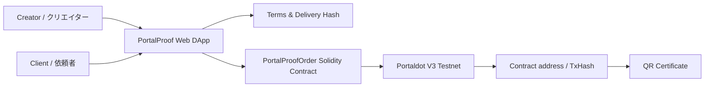

# PortalProof

日本語は英語セクションの直後に併記しています。

## One-sentence Overview

PortalProof is a creator workflow DApp that lets creators publish a request flow, record agreed work terms on Portaldot V3 testnet, and generate a delivery/payment proof certificate.

日本語訳: PortalProofは、クリエイターが依頼受付フローを公開し、合意した仕事内容をPortaldot V3テストネットに記録し、納品・支払い証明書を生成するDAppです。

## Track

Ecosystem DApps

日本語訳: エコシステムDApps部門

## Why Portaldot

Portaldot V3 supports EVM/Solidity contracts and ERC-style application development. PortalProof uses that capability to create verifiable creator work-order records on the Portaldot V3 testnet.

日本語訳: Portaldot V3はEVM/SolidityコントラクトとERC系アプリ開発に対応しています。PortalProofはその機能を使って、クリエイターの仕事依頼記録をPortaldot V3テストネット上に検証可能な形で残します。

## Current MVP Scope

- Creator request and client brief input
- Terms hash generation
- Minimal order-proof NFT contract on Portaldot V3 EVM
- Delivery URL hash recording
- Payment TxHash evidence recording
- QR certificate preview
- Clear separation between local draft data and real on-chain transaction evidence

日本語訳:

- クリエイター受付と依頼内容入力
- 合意条件Hash生成
- Portaldot V3 EVM上の最小発注証明NFTコントラクト
- 納品URL Hash記録
- 支払いTxHash証跡記録
- QR付き証明書プレビュー
- ローカル入力データと実オンチェーンTx証跡の明確な分離

## Portaldot V3 Testnet

From the official Portaldot V3 guide:

- Network: `PortaldotV3 Testnet`
- RPC: `https://testnetv3-eth-rpc.feso-apps.xyz`
- Chain ID: `420420777`
- Currency: `tPOTv3`
- Native token decimals: `14`

日本語訳:

- ネットワーク: `PortaldotV3 Testnet`
- RPC: `https://testnetv3-eth-rpc.feso-apps.xyz`
- Chain ID: `420420777`
- 通貨: `tPOTv3`
- ネイティブトークン小数桁: `14`

## Testnet Deployment

Not deployed yet.

日本語訳: まだデプロイしていません。

After deployment, fill in:

日本語訳: デプロイ後に以下を記入します。

| Item | Value |
| --- | --- |
| Contract address | TBD |
| Deployment TxHash | TBD |
| OrderCreated TxHash | TBD |
| DeliverySubmitted TxHash | TBD |
| PaymentRecorded TxHash | TBD |

## Architecture



## User Flow

1. Creator enters service details and wallet address.
2. Client enters request details and wallet address.
3. PortalProof hashes the agreed terms.
4. The connected wallet mints an order proof on Portaldot V3.
5. Creator records a delivery URL hash.
6. A verified payment TxHash is recorded only after sender, recipient, amount, and success are checked.
7. The certificate shows the contract, order ID, terms hash, payment TxHash, and QR code.

日本語訳:

1. クリエイターがサービス内容とウォレットアドレスを入力します。
2. 依頼者が依頼内容とウォレットアドレスを入力します。
3. PortalProofが合意条件をHash化します。
4. 接続ウォレットでPortaldot V3上に発注証明をmintします。
5. クリエイターが納品URLのHashを記録します。
6. 送金元、送金先、金額、成功状態を確認した支払いTxHashだけを記録します。
7. 証明書にコントラクト、注文ID、条件Hash、支払いTxHash、QRコードを表示します。

## Local Setup

```bash
npm install
npm run dev
```

日本語訳: 依存関係を入れて、ローカル開発サーバーを起動します。

## Compile Contract

The compiled artifact is included at `artifacts/PortalProofOrder.json` for the MVP deploy script. If the Solidity contract changes, recompile it with Remix or your preferred Solidity compiler and update the artifact.

日本語訳: MVP用デプロイスクリプトのため、コンパイル済みartifactを`artifacts/PortalProofOrder.json`に同梱しています。Solidityコントラクトを変更した場合は、Remixまたは任意のSolidityコンパイラで再コンパイルし、artifactを更新してください。

## Deploy to Portaldot V3

1. Add `PortaldotV3 Testnet` to MetaMask.
2. Get `tPOTv3` for the deployer account.
3. Copy `.env.example` to `.env`.
4. Set `DEPLOYER_PRIVATE_KEY`.
5. Run:

```bash
npm run deploy:portaldot
```

日本語訳:

1. MetaMaskに`PortaldotV3 Testnet`を追加します。
2. デプロイ用アカウントに`tPOTv3`を入れます。
3. `.env.example`を`.env`にコピーします。
4. `DEPLOYER_PRIVATE_KEY`を設定します。
5. `npm run deploy:portaldot`を実行します。

Do not commit `.env` or private keys.

日本語訳: `.env`や秘密鍵は絶対にコミットしないでください。

## AI and OSS Disclosure

AI-assisted development was used for implementation support, documentation drafting, and debugging. The project direction, product decisions, testing, and final submission are managed by the participant.

日本語訳: AI支援は実装補助、ドキュメント作成、デバッグに使用しました。プロジェクト方針、プロダクト判断、テスト、最終提出は参加者が管理しています。

Open-source dependencies are listed in `package.json`.

日本語訳: 使用しているOSS依存関係は`package.json`に記載しています。

## Known Limitations

- Payment TxHash verification is not fully automated yet.
- The current version prioritizes verifiable order proof transactions over polished UI.
- The app must not claim payment success from an arbitrary TxHash.

日本語訳:

- 支払いTxHashの完全自動検証はまだ未実装です。
- 現在のバージョンではUIの作り込みより、検証可能な発注証明Txを優先します。
- 任意のTxHashだけで支払い成功とは表示しません。
