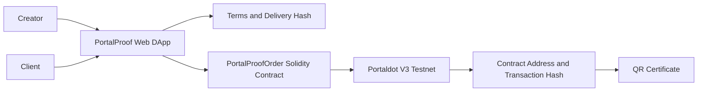
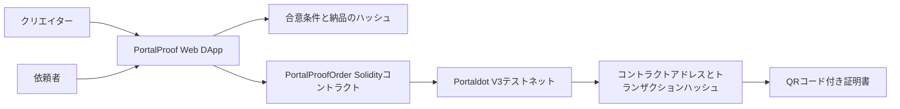

# PortalProof

## English

### One-sentence Overview

PortalProof is a creator workflow DApp that lets creators publish a request flow, record agreed work terms on the Portaldot V3 testnet, and generate a delivery and payment proof certificate.

### Track

Ecosystem DApps

### Why Portaldot

Portaldot V3 supports EVM and Solidity contracts as well as ERC-style application development. PortalProof uses that capability to create verifiable creator work-order records on the Portaldot V3 testnet.

### Current MVP Scope

- Creator request and client brief input
- Shareable creator request URL with service details and reference price
- Dedicated client form opened from the creator's link
- A creator dashboard with request-page settings and a multi-request inbox
- A creator-only home screen linking to request setup, job management, and the public-page preview
- A fully separate public request-submission page for clients
- A dedicated management workspace for each individual request
- A tabbed agreement, delivery, payment, and certificate workflow that avoids one long form
- Terms hash generation
- Minimal order-proof NFT contract on the Portaldot V3 EVM
- Delivery URL hash recording
- Payment transaction hash evidence recording
- QR certificate preview
- Clear separation between local draft data and real on-chain transaction evidence

### Portaldot V3 Testnet

According to the official Portaldot V3 guide:

- Network: `PortaldotV3 Testnet`
- RPC: `https://testnetv3-eth-rpc.feso-apps.xyz`
- Chain ID: `420420777`
- Currency: `tPOTv3`
- Native token decimals: `14`

### Testnet Deployment

Not deployed yet.

After deployment, fill in the following values:

| Item | Value |
| --- | --- |
| Contract address | TBD |
| Deployment transaction hash | TBD |
| OrderCreated transaction hash | TBD |
| DeliverySubmitted transaction hash | TBD |
| PaymentRecorded transaction hash | TBD |

### Architecture



### User Flow

1. From the creator-only home screen, the creator opens request setup, job management, or the public-page preview.
2. In request setup, the creator enters service details and a wallet address, then publishes a dedicated request link.
3. The client opens a fully separate public page with no link back to the creator home, reviews the service, and submits the request details and wallet address.
4. Each submission appears as a separate item in the creator's request inbox.
5. The creator opens the request's dedicated management workspace to review the agreement.
6. PortalProof hashes the agreed terms and the connected wallet mints an order proof on Portaldot V3.
7. The creator records a delivery URL hash in the delivery tab.
8. A verified payment transaction hash is recorded in the payment tab only after the sender, recipient, amount, and success status are checked.
9. The certificate tab shows the contract, order ID, terms hash, payment transaction hash, and QR code.

### Local Setup

```bash
npm install
npm run dev
```

### Compile Contract

The compiled artifact is included at `artifacts/PortalProofOrder.json` for the MVP deployment script. If the Solidity contract changes, recompile it with Remix or your preferred Solidity compiler and update the artifact.

### Deploy to Portaldot V3

1. Add `PortaldotV3 Testnet` to MetaMask.
2. Get `tPOTv3` for the deployer account.
3. Copy `.env.example` to `.env`.
4. Set `DEPLOYER_PRIVATE_KEY`.
5. Run the read-only network and wallet preflight:

```bash
npm run check:portaldot
```

6. After confirming the chain ID, deployer address, and balance, deploy the contract:

```bash
npm run deploy:portaldot
```

Do not commit `.env` files or private keys.

### AI and Open-source Software Disclosure

AI-assisted development was used for implementation support, documentation drafting, and debugging. The project direction, product decisions, testing, and final submission are managed by the participant.

Open-source dependencies are listed in `package.json`.

### Known Limitations

- Payment transaction hash verification is not fully automated yet.
- Until the Portaldot contract is deployed, incoming requests are stored only in the current browser for prototype testing and do not sync across devices.
- The application must not claim payment success from an arbitrary transaction hash.

---

# PortalProof

## 日本語

### 1文概要

PortalProofは、クリエイターが依頼受付フローを公開し、合意した仕事内容をPortaldot V3テストネットに記録して、納品・支払い証明書を生成するDAppです。

### 参加部門

エコシステムDApps部門

### Portaldotを採用する理由

Portaldot V3はEVM・SolidityコントラクトとERC形式のアプリケーション開発に対応しています。PortalProofはその機能を使い、クリエイターの仕事依頼記録をPortaldot V3テストネット上に検証可能な形で残します。

### 現在のMVP範囲

- クリエイター受付情報と依頼内容の入力
- サービス内容と参考価格を含む共有可能なクリエイター専用依頼受付URL
- クリエイターのリンクから開く依頼者専用フォーム
- 受付設定と複数の依頼一覧を備えたクリエイター管理画面
- 受付作成・仕事管理・依頼ページ確認へ移動するクリエイター専用TOP
- 管理画面から完全に分離した依頼者専用の公開送信ページ
- 依頼ごとに独立した案件管理画面
- 長いフォームを避けるため、合意・納品・支払い・証明書を切り替える案件管理画面
- 合意条件ハッシュの生成
- Portaldot V3 EVM上の最小発注証明NFTコントラクト
- 納品URLハッシュの記録
- 支払いトランザクションハッシュ証跡の記録
- QRコード付き証明書のプレビュー
- ローカルの下書きデータと実際のオンチェーントランザクション証跡の明確な分離

### Portaldot V3テストネット

Portaldot V3公式ガイドに記載された設定は次のとおりです。

- ネットワーク: `PortaldotV3 Testnet`
- RPC: `https://testnetv3-eth-rpc.feso-apps.xyz`
- チェーンID: `420420777`
- 通貨: `tPOTv3`
- ネイティブトークンの小数桁: `14`

### テストネットへのデプロイ

まだデプロイしていません。

デプロイ後に次の値を記入します。

| 項目 | 値 |
| --- | --- |
| コントラクトアドレス | 未定 |
| デプロイのトランザクションハッシュ | 未定 |
| 発注作成のトランザクションハッシュ | 未定 |
| 納品登録のトランザクションハッシュ | 未定 |
| 支払い記録のトランザクションハッシュ | 未定 |

### 構成



### 利用の流れ

1. クリエイター専用TOPから、受付作成・仕事管理・依頼ページ確認のいずれかを選びます。
2. 受付設定でサービス内容とウォレットアドレスを入力し、専用の依頼受付リンクを発行します。
3. 依頼者はクリエイターTOPへのリンクがない独立した公開ページを開き、サービスを確認して依頼内容とウォレットアドレスを送信します。
4. 送信された依頼を、クリエイター側の依頼一覧へ別々の案件として追加します。
5. クリエイターが依頼ごとの専用案件画面を開き、合意内容を確認します。
6. PortalProofが合意条件をハッシュ化し、接続したウォレットでPortaldot V3上に発注証明を発行します。
7. 納品タブで、クリエイターが納品URLのハッシュを記録します。
8. 支払いタブで、送金元、送金先、金額、成功状態を確認した支払いトランザクションハッシュだけを記録します。
9. 証明書タブに、コントラクト、注文ID、合意条件ハッシュ、支払いトランザクションハッシュ、QRコードを表示します。

### ローカルでの起動

```bash
npm install
npm run dev
```

### コントラクトのコンパイル

MVP用デプロイスクリプトで使うコンパイル済みファイルを`artifacts/PortalProofOrder.json`に同梱しています。Solidityコントラクトを変更した場合は、Remixまたは任意のSolidityコンパイラで再コンパイルし、同ファイルを更新してください。

### Portaldot V3へのデプロイ

1. MetaMaskに`PortaldotV3 Testnet`を追加します。
2. デプロイ用アカウントに`tPOTv3`を用意します。
3. `.env.example`を`.env`へコピーします。
4. `DEPLOYER_PRIVATE_KEY`を設定します。
5. 読み取り専用のネットワーク・ウォレット事前確認を実行します。

```bash
npm run check:portaldot
```

6. チェーンID、デプロイ用アドレス、残高を確認してからコントラクトをデプロイします。

```bash
npm run deploy:portaldot
```

`.env`ファイルや秘密鍵は絶対にコミットしないでください。

### AIとオープンソースソフトウェアの開示

AI支援は、実装補助、ドキュメント作成、デバッグに使用しました。プロジェクト方針、プロダクト判断、テスト、最終提出は参加者が管理しています。

使用しているオープンソース依存関係は`package.json`に記載しています。

### 現在の制限事項

- 支払いトランザクションハッシュの完全自動検証はまだ未実装です。
- Portaldotコントラクトをデプロイするまでは、試作用の受信依頼を現在のブラウザ内だけに保存するため、別端末とは同期されません。
- 任意のトランザクションハッシュだけで支払い成功とは表示しません。
