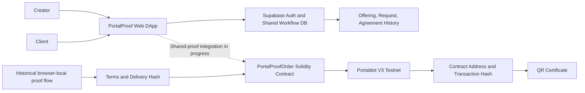
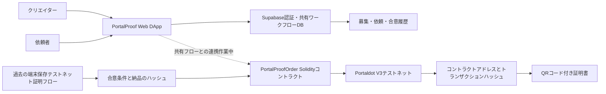

# PortalProof

<p align="center">
  
</p>

> Continuing this project in a new ChatGPT or Codex version? Start with [`docs/PROJECT_HANDOFF.md`](docs/PROJECT_HANDOFF.md). It records the canonical repository location, completed deployment state, verified testnet evidence, safety rules, and next priorities.

## English

### One-sentence Overview

PortalProof is a creator workflow DApp that lets creators publish a request flow, record agreed work terms on the Portaldot V3 testnet, and generate a delivery and payment proof certificate.

### Who PortalProof Is For

PortalProof is not limited to illustrators, artists, or people who identify as creators. Its intended scope includes anyone offering commissioned work, making something, or providing skills and services—for example, design, video production, software development, translation, handmade goods, consulting, and instruction. The interface continues to use “creator” as a familiar label for the person taking on the work.

These examples describe the product's intended audience, not a claim that every service-specific workflow is already implemented. The current delivery-proof flow uses a delivery URL; completion evidence for services without a deliverable file still needs to be defined and implemented.

### Track

Ecosystem DApps

### Live Demo

[Open PortalProof](https://nato-san.github.io/PortalProof/)

[Watch the short demo video](https://youtube.com/watch?v=5DtARDfIMM0)

The public root opens the shared workspace with wallet-signature login. Wallet sign-in has been confirmed from a phone, and mobile Safari and Chrome connect through the MetaMask app. The browser-local MVP and its historical testnet evidence below are preserved as an isolated recovery/demo flow and are not mixed into the normal public navigation. Shared delivery/payment/certificate integration is not yet complete. See [current navigation and mobile verification status](docs/NAVIGATION_MOBILE.md).

### Current Public Workflow

- Creators sign in by signing an authentication message with an EVM wallet. No email registration, payment, or gas fee is required for login.
- Creators can create multiple offerings, publish a separate shareable URL for each service, and close or reopen intake.
- The receiving wallet is taken automatically from the creator's verified wallet sign-in. It is no longer entered manually. Older wallet-owned offerings are corrected when their owner opens the creator workspace.
- Clients open an offering link, sign in with a different wallet, and submit a request without an on-chain transaction or gas fee.
- Offerings and requests are stored in Supabase so the creator and client can use separate devices and see records associated with their own authenticated wallet.
- Creator jobs are separated into new, approved, agreed, delivered, cancelled, and archived views. Archiving is only an owner-side list preference and does not cancel or delete the job.
- Before terms are agreed, the creator may decline with a reason. After agreement, cancellation requires approval from the other participant.
- Japanese and English guides are available from both the creator and client flows.

### Why Portaldot

Portaldot V3 supports EVM and Solidity contracts as well as ERC-style application development. PortalProof uses that capability to create verifiable creator work-order records on the Portaldot V3 testnet.

### Browser-local MVP Scope (historical testnet flow)

- Creator request and client brief input
- Shareable creator request URL with service details and reference price
- Dedicated client form opened from the creator's link
- A creator dashboard with request-page settings and a multi-request inbox
- A creator-only home screen linking to request setup, job management, and the public-page preview
- A visible local-demo / Portaldot V3 mode switch that prevents accidental on-chain writes while working locally
- A fully separate public request-submission page for clients
- A dedicated management workspace for each individual request
- A tabbed agreement, delivery, payment, and certificate workflow that avoids one long form
- Terms hash generation
- Lightweight append-only order-proof event log on the Portaldot V3 EVM
- Delivery URL hash recording
- Payment transaction hash evidence recording
- QR certificate preview
- Clear separation between local draft data and real on-chain transaction evidence

### Portaldot V3 Testnet

The native network settings below come from the official Portaldot V3 guide. The EVM decimal setting was verified against the latest EVM RPC balance and MetaMask display:

- Network: `PortaldotV3 Testnet`
- Native RPC: `wss://test-node-v3.portaldot.dev`
- EVM RPC: `https://test-evm-rpc-v3.portaldot.dev`
- Node Explorer: `https://node-console.portaldot.dev/`
- Chain ID: `420420777`
- Currency: `tPOTv3`
- Native token decimals: `14`
- EVM and MetaMask currency decimals: `18`

### Testnet Deployment

The lightweight proof contract was deployed successfully to the Portaldot V3 testnet on October 21, 2026.

| Item | Value |
| --- | --- |
| Contract address | `0xBaE8933886e1520e5FCa3eDed119c08b29022D79` |
| Deployment transaction hash | `0x29b2c7b2b91bf6cc6804040fb0590c020a3b0a4bdae1f81864f1f9f227035365` |
| Deployer | `0xCF0a9DE1AEE018647c16094caf7238E263659C6C` |
| Deployment cost | `69.04291640089190529 tPOTv3` |
| OrderCreated transaction hash | `0x2bcc608ac64194dbd08f8c0239bf12ce1ae4c7870f7ef9f59265a775bbb16815` |
| Duplicate test transaction | `0x6fd2728858d5278e43c0cec6618427a8505e048c87362f9dd43a2e7f023f6be7` (same proof ID; UI guard added afterward) |
| DeliverySubmitted transaction hash | `0x9f8e365d727c2c4cd5cbabd323f505313ea8d6fabcf25c1986d2acf801b76db9` |
| PaymentRecorded transaction hash | `0x632700e4ca21e59e47b0f9fa60beefd460b1c176695ab33438548cdcc7d8a3a0` |
| End-to-end test | Completed: order, delivery, verified native payment, and certificate |

The completed test confirms that PortalProof can verify the native payment sender, recipient, amount, and receipt status before recording the payment evidence on-chain. The generated certificate references the real order, delivery, and payment transactions shown above.

### Architecture



### User Flow

1. The creator signs in with a wallet and creates an offering with a service name and description. The verified login wallet is set automatically as the receiving wallet.
2. PortalProof creates a dedicated public request URL that can be shared on social media or sent directly to a client.
3. The client opens the URL on another device, signs in with a different wallet, and submits a name, brief, proposed amount, and requested deadline. Submission itself is off-chain and costs no gas.
4. The request is stored in the shared database with an immutable history entry and appears in both the creator's job list and the client's commission list.
5. The creator starts negotiation, accepts the original terms, proposes changed terms, or declines with a reason. Changed terms require client approval.
6. Before agreement the creator may decline; after agreement, a cancellation request must be approved by the other participant.
7. The creator manages the job by stage and may archive or restore it without changing its actual status.
8. The existing Portaldot V3 proof contract demonstrates order, delivery, and verified payment evidence. Connecting that full proof sequence to the new shared workflow is the current release gate.

### Local Setup

```bash
npm install
npm run dev
```

### Compile Contract

The compiled artifact is included at `artifacts/PortalProofOrder.json` for the MVP deployment script. The compiler is pinned to the Portaldot guide's Solidity `0.8.24` version and uses the optimizer with 200 runs. Recompile it after changing the contract:

```bash
npm run compile:contract
```

### Deploy to Portaldot V3

The production testnet contract has already been deployed once for the whole PortalProof application. Creators and clients reuse this shared contract and must not deploy their own copies.

For a future replacement deployment:

1. Add `PortaldotV3 Testnet` to MetaMask and fund the operator account with `tPOTv3`.
2. Open `?view=deploy` on the hosted application.
3. Connect the operator wallet and run the final read-only check.
4. Confirm the network, account, and maximum fee, then approve the deployment in MetaMask.

The deployment page never asks for a private key. A command-line read-only preflight is also available by setting `DEPLOYER_ADDRESS` and running:

```bash
npm run check:portaldot
```

Never commit `.env` files or private keys.

### AI and Open-source Software Disclosure

AI-assisted development was used for implementation support, documentation drafting, and debugging. The project direction, product decisions, testing, and final submission are managed by the participant.

Open-source dependencies are listed in `package.json`.

### Known Limitations

- The shared request and negotiation records synchronize across devices through Supabase, but delivery, payment verification, and certificate issuance are not yet connected end-to-end to this new shared workflow.
- The deployed Portaldot V3 contract and historical end-to-end evidence remain valid, but they must not be presented as proof that every newly submitted shared request is already recorded on-chain.
- Offerings created by the earlier email-auth prototype remain preserved under that earlier account. They are not silently transferred to a wallet account; create a new wallet-owned offering if an old offering does not appear in the creator's offering list.
- Payment verification currently supports native tPOTv3 transfers; token-contract payments are not supported yet.
- The current MVP records payment evidence after delivery but does not escrow funds, so payment is not guaranteed.
- The application must not claim payment success from an arbitrary transaction hash.
- A public delivery URL can be copied. The on-chain hash proves the recorded URL, but does not restrict access to the delivered file.

### Roadmap

#### Milestone 1 — Testnet proof MVP (completed)

- Completed and demonstrated the deployed order, delivery, and verified native-payment proof flow.
- Kept the non-custodial model: PortalProof records evidence but does not hold user funds.

#### Milestone 2 — Shared workflow completion (current)

- Complete the two-wallet, cross-device flow from offering publication through request, negotiation, agreement, delivery, and proof verification.
- Connect agreed shared jobs to the hardened contract workflow, then expose delivery, verified payment, and certificate evidence to both participants.
- Complete physical-device regression checks in mobile Safari and Chrome without losing navigation or wallet session state.

#### Milestone 3 — Escrow deposit and production hardening

- When the creator accepts a request, require the client to deposit the agreed native tPOTv3 amount into a dedicated escrow contract.
- Lock the deposit to the proof ID and the client and creator wallets.
- After delivery, let the client approve release to the creator.
- Support cancellation and refund before acceptance, plus a deadline-based refund when delivery does not occur.
- Do not reveal a protected delivery asset until the deposit is confirmed.

- Add revision and dispute states, timeout rules, and an explicit resolver or mutually agreed refund path.
- Add reentrancy protection, checks-effects-interactions, access control, invariant tests, and an external security review before handling real-value funds.
- Consider content encryption or signed, time-limited delivery links; a public URL alone cannot prevent copying.

---

# PortalProof

## 日本語

> 新しいChatGPT／Codexバージョンで開発を続ける場合は、最初に[`docs/PROJECT_HANDOFF.md`](docs/PROJECT_HANDOFF.md)を確認してください。正式な保存場所、完成状態、テストネット証跡、安全上の注意、次の作業をまとめています。

### 1文概要

PortalProofは、クリエイターが依頼受付フローを公開し、合意した仕事内容をPortaldot V3テストネットに記録して、納品・支払い証明書を生成するDAppです。

### 対象となる利用者

PortalProofは、イラストレーターやアーティスト、クリエイターと呼ばれる人だけに限定したアプリではありません。何かを制作する人、スキルやサービスを提供する人など、幅広い仕事の受発注を対象としています。例えば、デザイン、動画制作、開発、翻訳、ハンドメイド制作、相談・指導などを想定しています。画面上では親しみやすい呼び方として、仕事を受ける側を引き続き「クリエイター」と表記します。

これらは想定する利用対象であり、すべてのサービス固有の業務フローが実装済みという意味ではありません。現在の納品証明は納品URLを使う方式です。納品ファイルのないサービスの完了証跡については、今後の仕様検討・実装が必要です。

### 参加部門

エコシステムDApps部門

### 公開デモ

[PortalProofを開く](https://nato-san.github.io/PortalProof/)

公開ルートは、ウォレット署名ログインを使う共有ワークスペースへ統一しています。スマホからのウォレットログインを確認済みで、Safari・ChromeからMetaMaskアプリへ接続します。以下の端末保存MVPとテストネット証跡は、通常の公開導線と混ざらない独立した復旧・実演用フローとして保持しています。共有フローの納品・支払い・証明書連携は未完了です。[現在の導線・スマホ検証状況](docs/NAVIGATION_MOBILE.md)を確認してください。

### 現在の公開フロー

- クリエイターはEVMウォレットで認証メッセージに署名してログインします。メール登録、送金、ガス代は不要です。
- クリエイターは複数の募集を作成し、サービスごとの共有URLを公開できます。募集の受付停止・再開にも対応しています。
- 受取ウォレットは署名ログインで検証したウォレットを自動設定します。手入力は廃止しました。ウォレットアカウントが所有する既存募集も、所有者が管理画面を開くと自動補正します。
- 依頼者は募集URLを開き、クリエイターとは別のウォレットでログインして依頼を送信します。依頼送信時にオンチェーン取引やガス代は発生しません。
- 募集と依頼はSupabaseに保存され、クリエイターと依頼者が別端末から、それぞれ自分のウォレットに紐づく情報を確認できます。
- 案件は未処理、承認済、交渉済、納品済、キャンセル済、アーカイブに分けて管理します。アーカイブはクリエイター側だけの一覧整理であり、案件のキャンセルや削除ではありません。
- 条件合意前はクリエイターが理由を付けて辞退できます。条件合意後のキャンセルには、相手側の承認が必要です。
- クリエイター側・依頼者側の双方に、日本語・英語の使い方ガイドがあります。

### Portaldotを採用する理由

Portaldot V3はEVM・SolidityコントラクトとERC形式のアプリケーション開発に対応しています。PortalProofはその機能を使い、クリエイターの仕事依頼記録をPortaldot V3テストネット上に検証可能な形で残します。

### 端末保存MVPの範囲（過去のテストネット実演）

- クリエイター受付情報と依頼内容の入力
- サービス内容と参考価格を含む共有可能なクリエイター専用依頼受付URL
- クリエイターのリンクから開く依頼者専用フォーム
- 受付設定と複数の依頼一覧を備えたクリエイター管理画面
- 受付作成・仕事管理・依頼ページ確認へ移動するクリエイター専用TOP
- ローカル作業中の誤送信を防ぐ、ローカル実演／Portaldot V3モード切り替え
- 管理画面から完全に分離した依頼者専用の公開送信ページ
- 依頼ごとに独立した案件管理画面
- 長いフォームを避けるため、合意・納品・支払い・証明書を切り替える案件管理画面
- 合意条件ハッシュの生成
- Portaldot V3 EVM上の軽量な追記専用発注証明イベントコントラクト
- 納品URLハッシュの記録
- 支払いトランザクションハッシュ証跡の記録
- QRコード付き証明書のプレビュー
- ローカルの下書きデータと実際のオンチェーントランザクション証跡の明確な分離

### Portaldot V3テストネット

以下のネイティブネットワーク設定は、Portaldot V3公式ガイドに基づいています。EVM側の小数桁は、最新EVM RPCの残高とMetaMask表示が一致することを確認しています。

- ネットワーク: `PortaldotV3 Testnet`
- ネイティブRPC: `wss://test-node-v3.portaldot.dev`
- EVM RPC: `https://test-evm-rpc-v3.portaldot.dev`
- ノードエクスプローラー: `https://node-console.portaldot.dev/`
- チェーンID: `420420777`
- 通貨: `tPOTv3`
- ネイティブトークンの小数桁: `14`
- EVM・MetaMask側の通貨の小数桁: `18`

### テストネットへのデプロイ

軽量証明コントラクトは、2026年10月21日にPortaldot V3テストネットへ正常にデプロイされました。

| 項目 | 値 |
| --- | --- |
| コントラクトアドレス | `0xBaE8933886e1520e5FCa3eDed119c08b29022D79` |
| デプロイのトランザクションハッシュ | `0x29b2c7b2b91bf6cc6804040fb0590c020a3b0a4bdae1f81864f1f9f227035365` |
| デプロイ実行者 | `0xCF0a9DE1AEE018647c16094caf7238E263659C6C` |
| 実際のデプロイ費用 | `69.04291640089190529 tPOTv3` |
| 発注作成のトランザクションハッシュ | `0x2bcc608ac64194dbd08f8c0239bf12ce1ae4c7870f7ef9f59265a775bbb16815` |
| 重複したテスト取引 | `0x6fd2728858d5278e43c0cec6618427a8505e048c87362f9dd43a2e7f023f6be7`（同じ証明ID。後から画面側に重複防止を追加） |
| 納品登録のトランザクションハッシュ | `0x9f8e365d727c2c4cd5cbabd323f505313ea8d6fabcf25c1986d2acf801b76db9` |
| 支払い記録のトランザクションハッシュ | `0x632700e4ca21e59e47b0f9fa60beefd460b1c176695ab33438548cdcc7d8a3a0` |
| 一連の動作確認 | 発注・納品・検証済みネイティブ支払い・証明書まで完了 |

今回の一連のテストにより、PortalProofがネイティブ支払いの送金元、送金先、金額、成功状態を検証してから、支払い証跡をオンチェーンへ記録できることを確認しました。生成された証明書は、上記の実際の発注・納品・支払いトランザクションを参照します。

### 構成



### 利用の流れ

1. クリエイターがウォレットでログインし、サービス名と仕事内容を入力して募集を作成します。受取先には検証済みのログインウォレットを自動設定します。
2. PortalProofがSNSや依頼者へ共有できる専用の公開受付URLを発行します。
3. 依頼者は別端末でURLを開き、クリエイターとは別のウォレットでログインして、名前、依頼内容、希望金額、希望納期を送信します。送信はオフチェーンで、ガス代は不要です。
4. 依頼は変更履歴とともに共有データベースへ保存され、クリエイターの案件一覧と依頼者の依頼一覧の双方に表示されます。
5. クリエイターは商談を開始し、依頼者の条件を承認するか、変更条件を提案するか、理由を付けて辞退します。変更条件は依頼者の承認が必要です。
6. 合意前はクリエイターが辞退できます。合意後のキャンセルは、相手側の承認を必要とします。
7. クリエイターは案件を段階別に管理し、案件の状態を変えずにアーカイブ・復元できます。
8. 既存のPortaldot V3証明コントラクトでは、発注、納品、検証済み支払いの証跡を実演済みです。この証明フローを新しい共有案件へ接続することが、現在のリリース上の重要課題です。

### ローカルでの起動

```bash
npm install
npm run dev
```

### コントラクトのコンパイル

MVP用デプロイスクリプトで使うコンパイル済みファイルを`artifacts/PortalProofOrder.json`に同梱しています。コンパイラはPortaldot公式ガイドと同じSolidity `0.8.24`に固定し、最適化を200回設定で有効にしています。コントラクトを変更した場合は再コンパイルしてください。

```bash
npm run compile:contract
```

### Portaldot V3へのデプロイ

本番用テストネットコントラクトは、PortalProof全体で共有するものとしてすでに1回デプロイ済みです。クリエイターや依頼者が個別にデプロイする必要はありません。

将来、新しいコントラクトへ置き換える場合は次の手順を使います。

1. MetaMaskに`PortaldotV3 Testnet`を追加し、運営用アカウントに`tPOTv3`を用意します。
2. 公開アプリの`?view=deploy`を開きます。
3. 運営用ウォレットを接続し、読み取り専用の最終チェックを実行します。
4. ネットワーク、アカウント、最大手数料を確認して、MetaMaskでデプロイを承認します。

デプロイ画面で秘密鍵を入力することはありません。`DEPLOYER_ADDRESS`を設定すれば、次のコマンドでも読み取り専用の事前確認を実行できます。

```bash
npm run check:portaldot
```

`.env`ファイルや秘密鍵は絶対にコミットしないでください。

### AIとオープンソースソフトウェアの開示

AI支援は、実装補助、ドキュメント作成、デバッグに使用しました。プロジェクト方針、プロダクト判断、テスト、最終提出は参加者が管理しています。

使用しているオープンソース依存関係は`package.json`に記載しています。

### 現在の制限事項

- 共有受付と商談記録はSupabaseを通じて別端末間で同期しますが、新しい共有フローと納品・支払い検証・証明書発行は、まだ一連の動作として接続できていません。
- デプロイ済みPortaldot V3コントラクトと過去の一連のテスト証跡は有効ですが、新しく送信したすべての共有依頼がすでにオンチェーン記録されるという意味ではありません。
- 以前のメール認証試作版で作成した募集は、その以前のアカウントに保持されています。ウォレットアカウントへ自動移管しないため、募集一覧に表示されない古い募集は、ウォレットログイン後に新しく作り直してください。
- 支払い検証はネイティブtPOTv3送金に対応しています。トークンコントラクト経由の支払いにはまだ対応していません。
- 現在のMVPは納品後の支払い証跡を記録しますが、資金をエスクローしないため、支払いそのものは保証されません。
- 任意のトランザクションハッシュだけで支払い成功とは表示しません。
- 公開された納品URLはコピーできます。オンチェーンのハッシュは記録したURLを証明しますが、納品ファイルへのアクセスは制限しません。

### ロードマップ

#### マイルストーン1 — テストネット証明MVP（完了）

- デプロイ済みの発注・納品・検証済みネイティブ支払い証明フローを完成させ、実演しました。
- 資金を預からず、PortalProofは証跡のみを記録する構成を維持しました。

#### マイルストーン2 — 共有ワークフローの完成（現在）

- 2つのウォレットと別端末を使い、募集公開、依頼、商談、合意、納品、証明確認までを一連の流れとして完成させます。
- 合意済みの共有案件を強化版コントラクトへ接続し、納品・検証済み支払い・証明書の証跡を双方から確認できるようにします。
- スマホのSafari・Chromeで、導線やウォレットセッションを失わない実機回帰テストを完了します。

#### マイルストーン3 — デポジット型エスクローと本番向け強化

- クリエイターが依頼を承諾した時点で、依頼者が合意額のネイティブtPOTv3を専用エスクローコントラクトへ預けます。
- デポジットを証明ID、依頼者、クリエイターのウォレットに紐づけてロックします。
- 納品後、依頼者の承認によりクリエイターへ支払います。
- 承諾前のキャンセルと返金、未納品時の期限付き返金に対応します。
- デポジット確認前は、保護された納品物を公開しません。

- 手直し・異議申立て・期限・仲裁者または双方合意による返金フローを追加します。
- 再入防止、Checks-Effects-Interactions、アクセス制御、不変条件テスト、外部セキュリティレビューを実施してから実価値資金を扱います。
- 公開URLだけでは複製を防げないため、暗号化または署名付き・期限付き納品URLを検討します。
