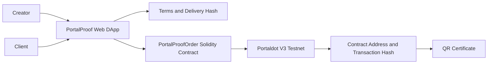
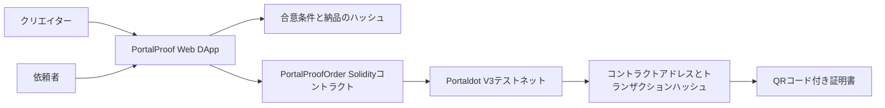

# PortalProof

## English

### One-sentence Overview

PortalProof is a creator workflow DApp that lets creators publish a request flow, record agreed work terms on the Portaldot V3 testnet, and generate a delivery and payment proof certificate.

### Track

Ecosystem DApps

### Live Demo

[Open PortalProof](https://nato-san.github.io/PortalProof/)

The public demo starts in local-demo mode so reviewers can explore the creator and client flows without a wallet or test tokens. Portaldot V3 mode remains available from the header for the on-chain flow.

### Why Portaldot

Portaldot V3 supports EVM and Solidity contracts as well as ERC-style application development. PortalProof uses that capability to create verifiable creator work-order records on the Portaldot V3 testnet.

### Current MVP Scope

- Creator request and client brief input
- Shareable creator request URL with service details and reference price
- Dedicated client form opened from the creator's link
- A creator dashboard with request-page settings and a multi-request inbox
- A creator-only home screen linking to request setup, job management, and the public-page preview
- A visible local-demo / Portaldot V3 mode switch that prevents accidental on-chain writes while working locally
- A fully separate public request-submission page for clients
- A dedicated management workspace for each individual request
- A tabbed agreement, delivery, payment, and certificate workflow that avoids one long form
- Terms hash generation
- Lightweight append-only order-proof event log on the Portaldot V3 EVM
- Delivery URL hash recording
- Payment transaction hash evidence recording
- QR certificate preview
- Clear separation between local draft data and real on-chain transaction evidence

### Portaldot V3 Testnet

The native network settings below come from the official Portaldot V3 guide. The EVM decimal setting was verified against the latest EVM RPC balance and MetaMask display:

- Network: `PortaldotV3 Testnet`
- Native RPC: `wss://test-node-v3.portaldot.dev`
- EVM RPC: `https://test-evm-rpc-v3.portaldot.dev`
- Node Explorer: `https://node-console.portaldot.dev/`
- Chain ID: `420420777`
- Currency: `tPOTv3`
- Native token decimals: `14`
- EVM and MetaMask currency decimals: `18`

### Testnet Deployment

The lightweight proof contract was deployed successfully to the Portaldot V3 testnet on October 21, 2026.

| Item | Value |
| --- | --- |
| Contract address | `0xBaE8933886e1520e5FCa3eDed119c08b29022D79` |
| Deployment transaction hash | `0x29b2c7b2b91bf6cc6804040fb0590c020a3b0a4bdae1f81864f1f9f227035365` |
| Deployer | `0xCF0a9DE1AEE018647c16094caf7238E263659C6C` |
| Deployment cost | `69.04291640089190529 tPOTv3` |
| OrderCreated transaction hash | `0x2bcc608ac64194dbd08f8c0239bf12ce1ae4c7870f7ef9f59265a775bbb16815` |
| Duplicate test transaction | `0x6fd2728858d5278e43c0cec6618427a8505e048c87362f9dd43a2e7f023f6be7` (same proof ID; UI guard added afterward) |
| DeliverySubmitted transaction hash | `0x9f8e365d727c2c4cd5cbabd323f505313ea8d6fabcf25c1986d2acf801b76db9` |
| PaymentRecorded transaction hash | `0x632700e4ca21e59e47b0f9fa60beefd460b1c176695ab33438548cdcc7d8a3a0` |
| End-to-end test | Completed: order, delivery, verified native payment, and certificate |

The completed test confirms that PortalProof can verify the native payment sender, recipient, amount, and receipt status before recording the payment evidence on-chain. The generated certificate references the real order, delivery, and payment transactions shown above.

### Architecture



### User Flow

1. From the creator-only home screen, the creator opens request setup, job management, or the public-page preview.
2. In request setup, the creator enters service details and a wallet address, then publishes a dedicated request link.
3. The client opens a fully separate public page with no link back to the creator home, reviews the service, and submits the request details and wallet address.
4. Each submission appears as a separate item in the creator's request inbox.
5. The creator opens the request's dedicated management workspace to review the agreement.
6. PortalProof hashes the agreed terms and the connected wallet mints an order proof on Portaldot V3.
7. The creator records a delivery URL hash in the delivery tab.
8. A verified payment transaction hash is recorded in the payment tab only after the sender, recipient, amount, and success status are checked.
9. The certificate tab shows the contract, order ID, terms hash, payment transaction hash, and QR code.

### Local Setup

```bash
npm install
npm run dev
```

### Compile Contract

The compiled artifact is included at `artifacts/PortalProofOrder.json` for the MVP deployment script. The compiler is pinned to the Portaldot guide's Solidity `0.8.24` version and uses the optimizer with 200 runs. Recompile it after changing the contract:

```bash
npm run compile:contract
```

### Deploy to Portaldot V3

The production testnet contract has already been deployed once for the whole PortalProof application. Creators and clients reuse this shared contract and must not deploy their own copies.

For a future replacement deployment:

1. Add `PortaldotV3 Testnet` to MetaMask and fund the operator account with `tPOTv3`.
2. Open `?view=deploy` on the hosted application.
3. Connect the operator wallet and run the final read-only check.
4. Confirm the network, account, and maximum fee, then approve the deployment in MetaMask.

The deployment page never asks for a private key. A command-line read-only preflight is also available by setting `DEPLOYER_ADDRESS` and running:

```bash
npm run check:portaldot
```

Never commit `.env` files or private keys.

### AI and Open-source Software Disclosure

AI-assisted development was used for implementation support, documentation drafting, and debugging. The project direction, product decisions, testing, and final submission are managed by the participant.

Open-source dependencies are listed in `package.json`.

### Known Limitations

- Payment verification currently supports native tPOTv3 transfers; token-contract payments are not supported yet.
- The current MVP records payment evidence after delivery but does not escrow funds, so payment is not guaranteed.
- The prototype request inbox is stored in the current browser and does not yet sync incoming requests across devices; accepted proofs are recorded separately on-chain.
- The application must not claim payment success from an arbitrary transaction hash.
- A public delivery URL can be copied. The on-chain hash proves the recorded URL, but does not restrict access to the delivered file.

### Roadmap

#### Milestone 1 — Interim-report MVP (current)

- Complete and demonstrate the deployed order, delivery, and verified native-payment proof flow.
- Keep the non-custodial model: PortalProof records evidence but does not hold user funds.

#### Milestone 2 — Escrow deposit

- When the creator accepts a request, require the client to deposit the agreed native tPOTv3 amount into a dedicated escrow contract.
- Lock the deposit to the proof ID and the client and creator wallets.
- After delivery, let the client approve release to the creator.
- Support cancellation and refund before acceptance, plus a deadline-based refund when delivery does not occur.
- Do not reveal a protected delivery asset until the deposit is confirmed.

#### Milestone 3 — Disputes and production hardening

- Add revision and dispute states, timeout rules, and an explicit resolver or mutually agreed refund path.
- Add reentrancy protection, checks-effects-interactions, access control, invariant tests, and an external security review before handling real-value funds.
- Consider content encryption or signed, time-limited delivery links; a public URL alone cannot prevent copying.

---

# PortalProof

## 日本語

### 1文概要

PortalProofは、クリエイターが依頼受付フローを公開し、合意した仕事内容をPortaldot V3テストネットに記録して、納品・支払い証明書を生成するDAppです。

### 参加部門

エコシステムDApps部門

### 公開デモ

[PortalProofを開く](https://nato-san.github.io/PortalProof/)

公開デモはローカル実演モードで始まるため、ウォレットやテストトークンがなくても、クリエイター側と依頼者側の流れを確認できます。オンチェーン処理用のPortaldot V3モードには、画面上部から切り替えられます。

### Portaldotを採用する理由

Portaldot V3はEVM・SolidityコントラクトとERC形式のアプリケーション開発に対応しています。PortalProofはその機能を使い、クリエイターの仕事依頼記録をPortaldot V3テストネット上に検証可能な形で残します。

### 現在のMVP範囲

- クリエイター受付情報と依頼内容の入力
- サービス内容と参考価格を含む共有可能なクリエイター専用依頼受付URL
- クリエイターのリンクから開く依頼者専用フォーム
- 受付設定と複数の依頼一覧を備えたクリエイター管理画面
- 受付作成・仕事管理・依頼ページ確認へ移動するクリエイター専用TOP
- ローカル作業中の誤送信を防ぐ、ローカル実演／Portaldot V3モード切り替え
- 管理画面から完全に分離した依頼者専用の公開送信ページ
- 依頼ごとに独立した案件管理画面
- 長いフォームを避けるため、合意・納品・支払い・証明書を切り替える案件管理画面
- 合意条件ハッシュの生成
- Portaldot V3 EVM上の軽量な追記専用発注証明イベントコントラクト
- 納品URLハッシュの記録
- 支払いトランザクションハッシュ証跡の記録
- QRコード付き証明書のプレビュー
- ローカルの下書きデータと実際のオンチェーントランザクション証跡の明確な分離

### Portaldot V3テストネット

以下のネイティブネットワーク設定は、Portaldot V3公式ガイドに基づいています。EVM側の小数桁は、最新EVM RPCの残高とMetaMask表示が一致することを確認しています。

- ネットワーク: `PortaldotV3 Testnet`
- ネイティブRPC: `wss://test-node-v3.portaldot.dev`
- EVM RPC: `https://test-evm-rpc-v3.portaldot.dev`
- ノードエクスプローラー: `https://node-console.portaldot.dev/`
- チェーンID: `420420777`
- 通貨: `tPOTv3`
- ネイティブトークンの小数桁: `14`
- EVM・MetaMask側の通貨の小数桁: `18`

### テストネットへのデプロイ

軽量証明コントラクトは、2026年10月21日にPortaldot V3テストネットへ正常にデプロイされました。

| 項目 | 値 |
| --- | --- |
| コントラクトアドレス | `0xBaE8933886e1520e5FCa3eDed119c08b29022D79` |
| デプロイのトランザクションハッシュ | `0x29b2c7b2b91bf6cc6804040fb0590c020a3b0a4bdae1f81864f1f9f227035365` |
| デプロイ実行者 | `0xCF0a9DE1AEE018647c16094caf7238E263659C6C` |
| 実際のデプロイ費用 | `69.04291640089190529 tPOTv3` |
| 発注作成のトランザクションハッシュ | `0x2bcc608ac64194dbd08f8c0239bf12ce1ae4c7870f7ef9f59265a775bbb16815` |
| 重複したテスト取引 | `0x6fd2728858d5278e43c0cec6618427a8505e048c87362f9dd43a2e7f023f6be7`（同じ証明ID。後から画面側に重複防止を追加） |
| 納品登録のトランザクションハッシュ | `0x9f8e365d727c2c4cd5cbabd323f505313ea8d6fabcf25c1986d2acf801b76db9` |
| 支払い記録のトランザクションハッシュ | `0x632700e4ca21e59e47b0f9fa60beefd460b1c176695ab33438548cdcc7d8a3a0` |
| 一連の動作確認 | 発注・納品・検証済みネイティブ支払い・証明書まで完了 |

今回の一連のテストにより、PortalProofがネイティブ支払いの送金元、送金先、金額、成功状態を検証してから、支払い証跡をオンチェーンへ記録できることを確認しました。生成された証明書は、上記の実際の発注・納品・支払いトランザクションを参照します。

### 構成



### 利用の流れ

1. クリエイター専用TOPから、受付作成・仕事管理・依頼ページ確認のいずれかを選びます。
2. 受付設定でサービス内容とウォレットアドレスを入力し、専用の依頼受付リンクを発行します。
3. 依頼者はクリエイターTOPへのリンクがない独立した公開ページを開き、サービスを確認して依頼内容とウォレットアドレスを送信します。
4. 送信された依頼を、クリエイター側の依頼一覧へ別々の案件として追加します。
5. クリエイターが依頼ごとの専用案件画面を開き、合意内容を確認します。
6. PortalProofが合意条件をハッシュ化し、接続したウォレットでPortaldot V3上に発注証明を発行します。
7. 納品タブで、クリエイターが納品URLのハッシュを記録します。
8. 支払いタブで、送金元、送金先、金額、成功状態を確認した支払いトランザクションハッシュだけを記録します。
9. 証明書タブに、コントラクト、注文ID、合意条件ハッシュ、支払いトランザクションハッシュ、QRコードを表示します。

### ローカルでの起動

```bash
npm install
npm run dev
```

### コントラクトのコンパイル

MVP用デプロイスクリプトで使うコンパイル済みファイルを`artifacts/PortalProofOrder.json`に同梱しています。コンパイラはPortaldot公式ガイドと同じSolidity `0.8.24`に固定し、最適化を200回設定で有効にしています。コントラクトを変更した場合は再コンパイルしてください。

```bash
npm run compile:contract
```

### Portaldot V3へのデプロイ

本番用テストネットコントラクトは、PortalProof全体で共有するものとしてすでに1回デプロイ済みです。クリエイターや依頼者が個別にデプロイする必要はありません。

将来、新しいコントラクトへ置き換える場合は次の手順を使います。

1. MetaMaskに`PortaldotV3 Testnet`を追加し、運営用アカウントに`tPOTv3`を用意します。
2. 公開アプリの`?view=deploy`を開きます。
3. 運営用ウォレットを接続し、読み取り専用の最終チェックを実行します。
4. ネットワーク、アカウント、最大手数料を確認して、MetaMaskでデプロイを承認します。

デプロイ画面で秘密鍵を入力することはありません。`DEPLOYER_ADDRESS`を設定すれば、次のコマンドでも読み取り専用の事前確認を実行できます。

```bash
npm run check:portaldot
```

`.env`ファイルや秘密鍵は絶対にコミットしないでください。

### AIとオープンソースソフトウェアの開示

AI支援は、実装補助、ドキュメント作成、デバッグに使用しました。プロジェクト方針、プロダクト判断、テスト、最終提出は参加者が管理しています。

使用しているオープンソース依存関係は`package.json`に記載しています。

### 現在の制限事項

- 支払い検証はネイティブtPOTv3送金に対応しています。トークンコントラクト経由の支払いにはまだ対応していません。
- 現在のMVPは納品後の支払い証跡を記録しますが、資金をエスクローしないため、支払いそのものは保証されません。
- 試作版の依頼一覧は現在のブラウザ内に保存されるため、受信依頼はまだ別端末と同期されません。受付後の証明記録は別途オンチェーンへ送信します。
- 任意のトランザクションハッシュだけで支払い成功とは表示しません。
- 公開された納品URLはコピーできます。オンチェーンのハッシュは記録したURLを証明しますが、納品ファイルへのアクセスは制限しません。

### ロードマップ

#### マイルストーン1 — 中間報告向けMVP（現在）

- デプロイ済みの発注・納品・検証済みネイティブ支払い証明フローを完成させて実演します。
- 資金を預からない構成を維持し、PortalProofは証跡のみを記録します。

#### マイルストーン2 — デポジット型エスクロー

- クリエイターが依頼を承諾した時点で、依頼者が合意額のネイティブtPOTv3を専用エスクローコントラクトへ預けます。
- デポジットを証明ID、依頼者、クリエイターのウォレットに紐づけてロックします。
- 納品後、依頼者の承認によりクリエイターへ支払います。
- 承諾前のキャンセルと返金、未納品時の期限付き返金に対応します。
- デポジット確認前は、保護された納品物を公開しません。

#### マイルストーン3 — 紛争対応と本番向け強化

- 手直し・異議申立て・期限・仲裁者または双方合意による返金フローを追加します。
- 再入防止、Checks-Effects-Interactions、アクセス制御、不変条件テスト、外部セキュリティレビューを実施してから実価値資金を扱います。
- 公開URLだけでは複製を防げないため、暗号化または署名付き・期限付き納品URLを検討します。
